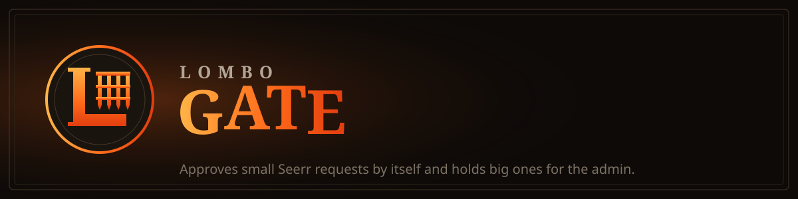

<p align="center"></p>

<p align="center">
  <a href="LICENSE"></a>
  <a href="https://github.com/Lombo-Forge/lombo-gate/actions/workflows/ci.yml"></a>
  <a href="https://github.com/Lombo-Forge/lombo-gate/actions/workflows/codeql.yml"></a>
  <a href="https://github.com/Lombo-Forge/lombo-gate/releases"></a>
  
  <a href="https://ko-fi.com/datlombardo"></a>
</p>

# LomboGate

Approves small [Seerr](https://github.com/seerr-team/seerr) requests by itself and holds big ones for you. Nobody waits for you to approve one season, and twenty seasons do not start downloading without you.

> **Status: not run against a real Seerr yet.** Tested only against fake Seerr and Sonarr servers (Sonarr 4's default quality sizes were checked on a real one). Keep it in dry-run mode until `plan` shows what you expect.

```text
$ lombo-gate plan
would approve request 41 (Alex, Short Show): 1 season(s), about 25 GB
holding request 42 (Sam, Long Show): 12 seasons (limit 5) and about 640 GB (limit 125)
left waiting request 43 (Kim, TMDB 603): 4K requests are the admin's to approve
```

## Contents

- [What it does and does not do](#what-it-does-and-does-not-do)
- [Install in a minute](#install-in-a-minute)
- [Commands](#commands)
- [Settings](#settings)
- [FAQ](#faq)
- [Contributing and licence](#contributing-and-licence)

## What it does and does not do

Every round (each minute by default) it looks at the requests waiting in Seerr:

| Request | What happens |
|---|---|
| TV within both limits | Approved |
| TV with more seasons than `MAX_SEASONS`, or an estimate over `MAX_GB` | Left waiting; you get one alert |
| TV whose size cannot be estimated | Left waiting; you get one alert |
| Movie | Approved (movies are not size-checked) |
| Anything 4K | Left waiting |

You approve or decline held requests in Seerr as usual. It **never** declines or deletes anything, and it **does not look at what a title is about**: ratings and content are not checked.

The size is a rough guess: episodes x episode length x the preferred size per minute that Sonarr holds for one quality. It does not know which quality profile a request will use. An announced season with no episodes yet counts as nothing.

## Install in a minute

**First, in Seerr, turn off auto-approve** for the people the limits should apply to, and for new users. Seerr approves their requests instantly otherwise, before this app can see them.

1. Copy `.env.example` to `.env` and fill in the Seerr and Sonarr URLs and API keys.
2. Start it:
   ```sh
   docker compose -f compose.example.yaml up -d
   docker compose -f compose.example.yaml exec lombo-gate lombo-gate doctor
   ```

`doctor` names anyone who still has auto-approve. It starts in dry-run mode: run `lombo-gate plan`, then set `LOMBO_GATE_DRY_RUN=false` when you are happy. While it is stopped or in dry run, requests simply wait.

## Commands

| Command | What it does |
|---|---|
| `lombo-gate doctor` | Checks settings, Seerr, Sonarr and who bypasses the gate. Exit code 1 if anything fails. |
| `lombo-gate plan` | Shows what would happen to each waiting request. Never changes anything. |
| `lombo-gate run [--loop]` | Does it. `--loop` repeats every `LOMBO_GATE_INTERVAL_SECONDS`. |

## Settings

Everything is an environment variable, listed with defaults in [.env.example](.env.example).

## FAQ

**What if Sonarr is down?** TV requests wait and are tried again. Movies are still approved.

**Which key does it need?** Seerr's API key, which has full control of Seerr. Keep `.env` private.

**Can it approve something I would not want?** Yes: anything within the limits, and every non-4K movie.

## Contributing and licence

Contribution, security and conduct rules come from the [Lombo-Forge organisation](https://github.com/Lombo-Forge/.github). Licensed under [GPL-3.0](LICENSE). Credits are in [NOTICE.md](NOTICE.md). Not affiliated with or endorsed by the Seerr, Sonarr or Jellyfin projects.
